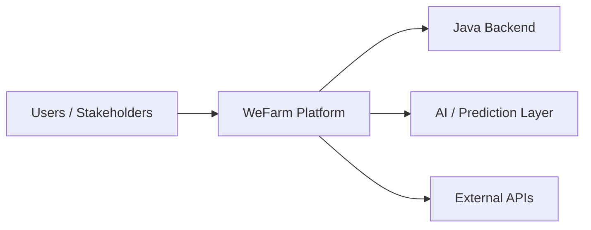

# WeFarm Smart Agriculture Platform

WeFarm is a smart agriculture management platform built to digitalize farm operations, connect stakeholders, and support decision-making with AI-assisted features.

## Overview

The platform focuses on practical agricultural management use cases:

- user and stakeholder management
- land and event tracking
- job and product workflows
- equipment and inventory management
- predictive and automated features

## Architecture

## Tech Stack

- Java
- Web application modules
- AI / prediction components
- External API integrations

## Repository Structure

- `src/` application source
- `pom.xml` build configuration
- `images/` project visuals
- `contrat_transaction_0.pdf` supporting document

## Getting Started

- Open the project in your Java IDE
- Install the dependencies declared in `pom.xml`
- Run the application from the main entry point or the configured build task
- Validate the main user flows and integration points

## Branching and Commits

- Use branches such as `feat/<area>`, `fix/<area>`, `docs/<area>`, or `refactor/<area>`
- Keep commits focused on one feature or one module
- Prefer Conventional Commits such as `feat(farm): add event tracking module`
- Avoid vague messages like `update`, `working`, or `final`

## Contributing

- Keep the architecture modular and easy to navigate
- Document any new external integration or data dependency
- Avoid committing IDE metadata or generated build artifacts
